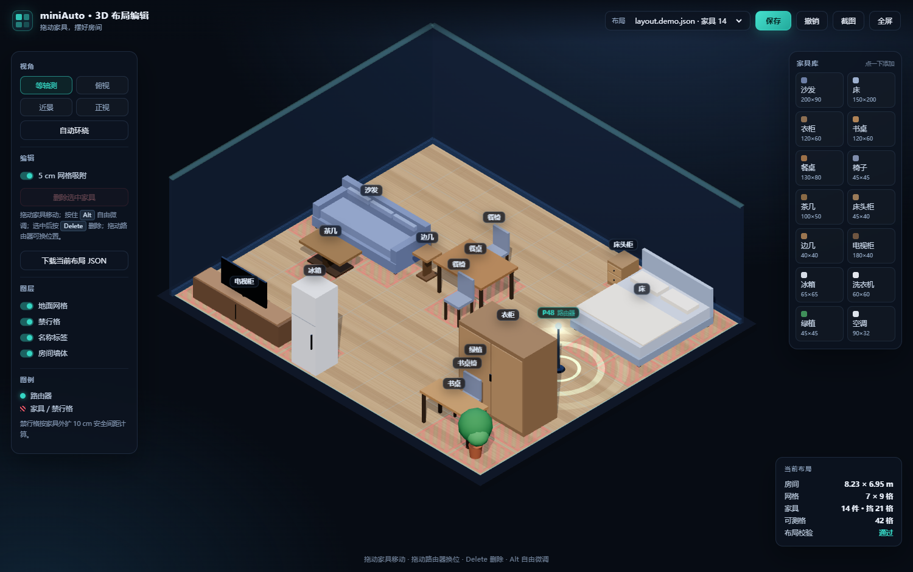

# miniAuto 3D 布局编辑器

在浏览器里用 3D 沙盘摆放家具、调整路由器位置，为 miniAuto Wi-Fi 采集系统准备房间布局。
纯本地运行，断网可用，不依赖任何云服务。



## 功能

- 3D 房间、墙体、地面网格，家具按类型参数化建模
- 拖动家具移动，默认 5 cm 吸附，按住 `Alt` 自由微调
- 右侧家具库，点一下自动找空位添加家具
- 选中家具后删除，支持撤销
- 拖动路由器按格子吸附，位置可保存
- 禁行格按 10 cm 安全间距实时计算
- 布局校验：家具重叠、路由器被挡、可测格统计
- 保存为新的 JSON，不覆盖原布局
- 一键截图、四种视角、图层开关

## 快速开始

需要 Python 3.9+，只用标准库，不需要安装任何依赖。

Windows 下双击 `start.bat`，浏览器会自动打开。

也可以命令行启动：

```bash
python server.py
```

然后打开 `http://127.0.0.1:8765/`。

## 目录

```
.
├── start.bat            双击启动
├── server.py            本地 HTTP 服务 + 分析/保存 API
├── core/                复用原系统的布局与路线模块
│   ├── layout.py
│   └── route_planner.py
├── data/                布局 JSON
│   ├── layout.json      默认空白房间
│   ├── layout.demo.json 示例房间（14 件家具）
│   └── layout.example.json
├── web/
│   ├── index.html
│   ├── app.js
│   ├── scene.js
│   ├── style.css
│   └── vendor/          three.js r160（MIT，离线）
└── docs/
    └── screenshot.png
```

## 数据格式

布局 JSON 与原 miniAuto 采集系统兼容：

```json
{
  "version": 2,
  "room": { "rows": 7, "columns": 9, "width_m": 8.23, "height_m": 6.95 },
  "clearance_m": 0.1,
  "ap": "P48",
  "start": "P11",
  "furniture": [
    { "name": "沙发", "x1": 0.3, "y1": 2.6, "x2": 2.55, "y2": 3.55 }
  ],
  "manual_blocked": []
}
```

家具使用米制轴对齐矩形，原点为房间左上角，与 2D 控制台一致。

## 技术说明

- 前端：原生 three.js（ES module），正交相机等轴测视角，无构建步骤
- 后端：Python 标准库 `http.server`，提供场景、分析、保存接口
- 格子判定与路线规划复用原系统的 `layout.py` / `route_planner.py`，保证 3D 与 2D 结果一致
- three.js 已本地化到 `web/vendor/`，不依赖 CDN

## 授权说明

`core/layout.py`、`core/route_planner.py` 来自 miniAuto Wi-Fi 采集系统，公开前请确认你有权发布这部分代码。
three.js 使用 MIT 许可证，见 `web/vendor/LICENSE-three.txt`。

## 致谢

- [three.js](https://threejs.org/) — MIT License
- 原始 miniAuto Wi-Fi 采集系统
