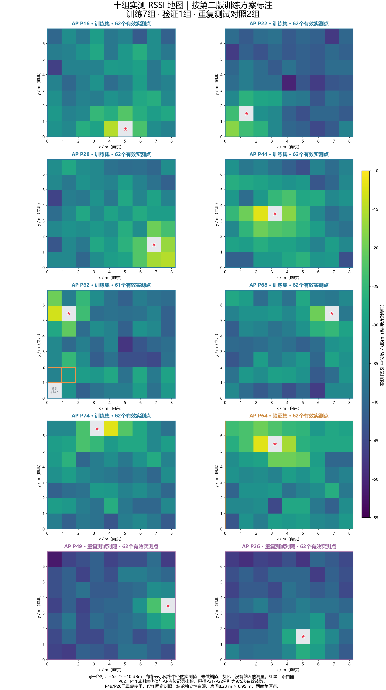
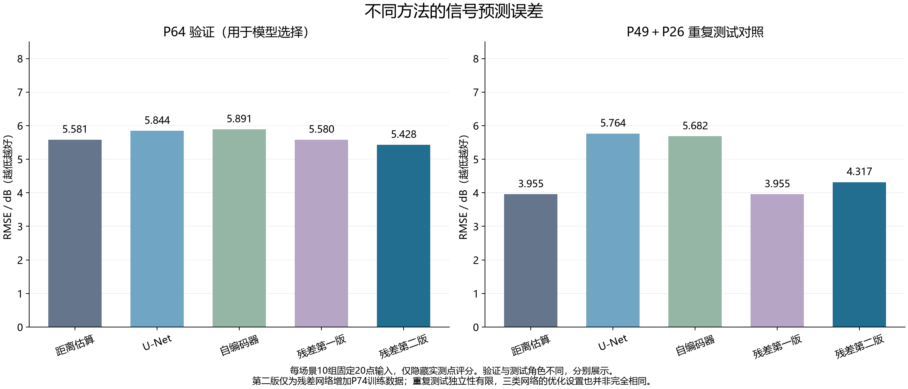
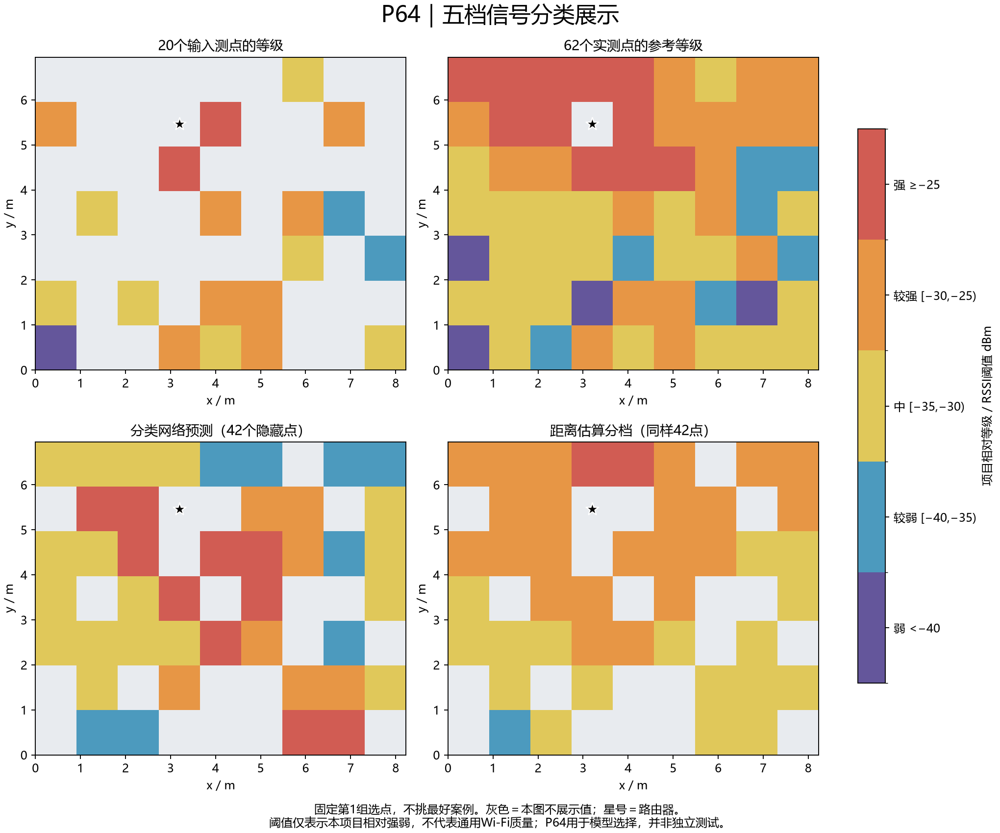

# 室内 Wi-Fi RSSI 地图补全与五档分类

小组实验项目：输入房间内部分位置的实测 RSSI，预测其他位置的信号强度或相对强弱等级。此仓库保存真实测量整理数据、实验代码、已训练权重及初步结果。

**当前结论：回归网络尚未稳定超过 IDW 距离估算；五档分类仍处于初步验证阶段。** 分档改善展示可读性，不代表提升了物理预测精度。

## 实验场景与数据

房间约 8.23 m × 6.95 m，内部无明显遮挡；西南角原点，x向东、y向北。7行9列测点，改变路由器位置形成10个部署，共619个可用位置记录。每个RSSI目标为有效采样中位数，第一版只使用RSSI，不使用CSI作为网络输入。

|用途（当前版本）|路由器位置|可用点数|
|---|---|---:|
|训练|P16、P22、P28、P44、P62、P68、P74|433|
|验证|P64|62|
|重复测试对照|P49、P26|124|

数据入口：[场景索引](data/scene_index.json)。九组统一点表在 [training_points.csv](output/training_tables_v1/training_points.csv)，P74单独位置见索引。第一版不含P74，第二版与分类版加入P74。



## 实验方案

1. 卷积补全自编码器：三通道输入、连续RSSI回归。
2. 小型U-Net：三通道输入、连续RSSI回归。
3. 插值引导残差U-Net：输入点生成IDW初图，网络学习修正；保存六组/七组训练的两版。
4. 五档分类U-Net：四通道输入（稀疏RSSI、观测标记、房间标记、输入点IDW图），直接输出五个类别概率，交叉熵训练，无RSSI回归输出。

训练每场景随机输入20个已测点，仅在剩余有效实测点算损失；验证采用固定10组输入，用P64选权重。隐藏答案不参与输入点插值。未测点不当作0信号或真实答案。

## 五档规则（本项目相对等级）

|等级|RSSI dBm|
|---|---|
|强|≥ -25|
|较强|-30 ≤ RSSI < -25|
|中|-35 ≤ RSSI < -30|
|较弱|-40 ≤ RSSI < -35|
|弱|< -40|

规则根据训练数据范围固定，**不是通用Wi-Fi可用性、网速或服务质量标准**。

## 初步结果

回归的RMSE单位为dB，越低越好：

|方法|P64验证|P49/P26重复测试合并|
|---|---:|---:|
|IDW|5.581|3.955|
|小型U-Net|5.844|5.764|
|自编码器|5.891|5.682|
|残差第一版|5.580|3.955|
|残差第二版（加入P74）|5.428|4.317|



分类版仅检查了P64，未再次对P49/P26评分：

|方法|类别准确率|五类宏平均F1|相差不超过一档|
|---|---:|---:|---:|
|五档分类网络|42.6%|0.341|72.4%|
|IDW按同一阈值分档|42.1%|0.250|87.6%|

分类网络准确率略高，但跨两档及以上的错误更多，不能认为整体更优；“弱”类识别仍不足。分类指标与回归误差不能直接比较。



详细报告：[回归比较](output/reused_test_v1_v2/REPORT.md)、[回归PDF](output/reused_test_v1_v2/两版残差网络_验证与重复测试比较报告.pdf)、[分类报告](output/classification_runs/20261022_135426_063941/REPORT.md)、[训练曲线](output/experiment_visuals_20261021/03_两版训练曲线.png)。

## 安装与使用

所有命令在仓库根目录运行；已验证Windows、Python3.14.7、PyTorch2.11.0+cu128，CPU可用于加载推理。

```cmd
python -m venv .venv
.venv\Scripts\python.exe -m pip install -r requirements.txt
```

需要相同CUDA构建时，再按硬件条件安装PyTorch官方对应版本；本次使用：

```cmd
.venv\Scripts\python.exe -m pip install torch==2.11.0 --index-url https://download.pytorch.org/whl/cu128
```

### 直接加载分类模型（不重新训练）

```cmd
.venv\Scripts\python.exe rss_classifier.py --model output/classification_runs/20261022_135426_063941/best_model.pt --input examples/rss_input_20points.csv --output output/my_classification.csv
```

输入CSV列为 `point_id,rssi_dbm`。输出63个网格中心的类别和概率；概率未经校准，不等于真实正确率。示例输入来自已有P49记录，仅演示推理，不是新测试。输入仍需数值RSSI，输出才是类别。

### 加载回归模型

```cmd
.venv\Scripts\python.exe predict_rss.py --model output/residual_v2_runs/20261021_154833_150288/best_model.pt --input examples/rss_input_20points.csv --output output/my_rssi_prediction.csv
```

### 重新训练

```cmd
.venv\Scripts\python.exe check_training_data.py
.venv\Scripts\python.exe train_rss_unet.py
.venv\Scripts\python.exe train_autoencoder.py
.venv\Scripts\python.exe train_residual_rss.py --include-p74
.venv\Scripts\python.exe rss_classifier.py
```

每次训练写入新时间戳目录。报告/绘图/比较脚本默认引用本仓库保存的那次历史运行；要评价新权重，需要更新模型路径，不能把默认报告当新模型结果。

## 3D 布局编辑器

[`3d-layout-editor/`](3d-layout-editor/) 是一个本地运行的 3D 房间沙盘：可以拖动家具、从家具库添加家具、调整路由器位置，并导出与原采集系统兼容的 `layout.json`，适合在采集前核对家具布局。

双击 `3d-layout-editor/start.bat`，或在仓库根目录运行 `python 3d-layout-editor/server.py`，浏览器会自动打开。详细说明见 [`3d-layout-editor/README.md`](3d-layout-editor/README.md)。

## 重要限制

- P49/P26已重复使用，目前仅为固定前后对照，独立性有限；P64也反复用于模型选择，不是新独立测试。
- P62的采集程序忘记改AP位置，已由采集者确认实际AP为P62；排除该占位点记录和无原始读数的P11试测替代值。该轮P21/P22仅9/5条有效读数，保留已有中位数。
- P49/P26逐包RSSI与其他场景接口轮询采样不同；高度未记录。不能把部署差异与采样方式差异完全分离。
- 只在同一房间少数部署验证，未验证跨房间。空旷房间可能让IDW有竞争力，但尚未单独验证因果。
- 原始大型NPZ、聊天附件、虚拟环境未上传；保留整理数据与来源说明。全部权重是自己的已训练成果，原始档案保留于本地。
- 从其他电脑重新训练可能受随机性和环境影响；加载相同权重、输入与处理规则应得到相近预测。

## 团队协作

队友接受仓库邀请后，在独立分支提交修改并发起Pull Request。新增实验保留数据划分、随机种子、完整设置与结果；不要覆盖原始测量或用测试成绩反复选模型。成员与分工可由小组在此补充。
