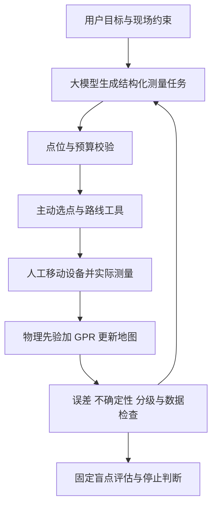

# 让 AI 参与测量决策

建议把项目定位为“物理先验与主动测量驱动的室内无线电地图智能构建”。目前已有 AI 预测模型；下一步让它参与选点、数据反馈和实验决策。大模型则承担理解现场条件、调用工具、核对结果和修订计划的角色。

## 推荐结构

大模型的价值应体现在“理解条件后改变实际执行计划”，例如：

> 只能再测 6 个点，P11 和 P12 目前不能进入，优先检查较差/一般信号交界处，剩余时间不足就先做最有价值的三点。

大模型把这些要求转成已校验的预算、排除点位和任务目标，由数值模块选点。测量回来后，调用工具检查异常并更新地图，再决定下一步。当前工具已支持点位排除，分级交界优先、时间预算、路线优化和真实大模型调度尚未实现。

## 分阶段落实

| 阶段 | 核心工作 | 怎样检验 | 当前状态 |
|---|---|---|---|
| 预测 | 物理先验、GPR、神经网络补图 | 隐藏点 MAE、RMSE、五档一致率 | 已完成 |
| 决策 | 根据当前观测选择下一测点并更新地图 | 同预算误差、误差随测量数的曲线 | 已完成离线方差采样基线，无稳定优势 |
| 语言与行动 | 大模型解析现场约束并调用选点、检查、绘图工具 | 约束违反率、正确工具调用率、任务完成率、耗时 | 已有工具与参数定义，未接入大模型 |
| 场景理解 | 从实际平面图提取墙体、门、可达区域，人工核实后使用 | 几何提取误差、加入几何先验后的预测改善 | 待提供并核对场景信息 |
| 迁移 | 在新 AP 或新房间少量校准后预测 | 冻结模型后的独立场景误差 | 需要新数据，当前无法证明 |

当前不建议仅为“更像 AI”扩大 U-Net。8 组同房间数据下，原实验神经网络尚未胜过物理先验方法。可先研究低数据量下，信息采集方式与物理先验能否带来可复现收益。

## 怎样证明大模型有用

固定一批含真实现场约束的任务，至少比较：

1. 固定数值策略，不使用大模型。
2. 同一套工具加大模型调度。
3. 大模型只生成解释，不允许改变计划。

预测器、测量预算、候选点、初始观测和评估点保持一致。重点比较任务完成率、违反约束次数、人工修改次数、总耗时和固定评估点误差。若第二种只改善交互耗时而没有降低 RMSE，就如实表述为实验自动化收益；不能归为预测精度提升。

也应允许规则解析器作为简单对照，检验是否真的需要大模型。测量值只能来自设备；仿真值或大模型推断不得混入实测标签。模型不能根据测试集反复改规则再把它叫盲测。

## 刚完成的主动测量试验

每个场景 20 次回放、每次固定隐藏 20 点，三种策略从相同 6 点起步。P62：12 点预算下方差采样 RMSE 为 5.581 dB，随机为 5.913 dB；P74 分别为 4.543 和 4.509 dB。结果说明当前方差策略还不稳，下一步应先在训练/验证数据上研究选择规则，再用未参与设计的新场景检验。

P62 与 P74 均已在既有实验中被检查过；此次结果仅供探索，不是新盲测。报告、轨迹和代码见 `results/active_sampling/` 与 `scripts/benchmark_active_sampling.py`。主动无线电地图采样已有相关研究，例如 [Bayesian Active Learning for Sample Efficient 5G Radio Map Reconstruction](https://doi.org/10.1109/TWC.2024.3483112)，本项目的简单基线不能当作算法原创性或论文复现证明。

现阶段最值得争取的成果是：一个能在约束下执行、能说明每一步依据、并且能用固定评估协议证明价值的 AI 测量系统。
