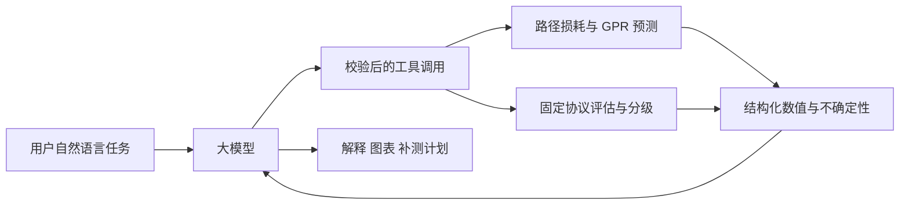

# 把大模型用于实验助手

当前只有 8 组同房间数据。优先使用已有物理模型与 GPR 计算信号，让大模型调用工具并解释证据；不使用这些地图微调一个语言模型来直接编造信号值。

## 最值得先做的功能

1. **实验问答与报告**：例如“P74 用 12 个输入点，各模型误差多大？”读取已计算的指标，给出来源、样本数和限制。只讨论实际返回的数值。
2. **补测规划**：给定当前实测点、AP 和固定 GPR 模型，按预测不确定性推荐下一批点。大模型理解“不能进入某区域”等现场约束，并解释路线；候选点排序由数值工具完成。
3. **数据检查**：检查缺测、重复点、AP 点冲突、组标签变化、训练测试重叠，生成待核实事项，不静默更改原始测量值。
4. **自然语言画图**：用户指定 AP、预算和分级阈值，大模型调用已经验证的预测和绘图程序，返回有来源标注的图与报告。

## 已提供的本地工具

`scripts/assistant_tools.py` 的 `analyze_observations(ap, observations, count, excluded_points)` 接收结构化观测数组与不可测点位，返回 63 格预测、实验相对五档和补测候选。观测格保留实测值，AP 格排除；补测不读取隐藏真值。

补测采用贪心条件方差：每次选当前预测方差最大的可测点，再以该点预测均值作临时观测更新协方差，继续选择，避免一批推荐挤在一起。临时值只用于规划，不写成真实测量，也不进入评估。方差排序依赖固定模型假设，**尚未证明能降低实际采集成本**。

`llm_tool_schema.json` 给出了可用于模型函数调用的严格参数定义。服务端须使用工具白名单并再次验证参数；模型不能指定任意本地文件路径或任意命令。观测、数值输出和版本应一起记录，便于复核。

官方函数调用流程是模型提出工具调用、应用执行函数，再把结果交回模型生成回答，见 [Function calling](https://developers.openai.com/api/docs/guides/function-calling)。报告需要固定字段时可使用 [Structured Outputs](https://developers.openai.com/api/docs/guides/structured-outputs)。结构化输出保证形式符合要求，不能代替事实核验。

现在可离线运行本地工具，未连接远程大模型 API。接入时只需将已校验的函数调用映射到该 Python 函数；密钥由运行环境提供，不提交仓库。把采集文件中的说明当作数据内容，不作为改变工具权限或实验协议的指令。

## 怎样量化大模型带来的价值

在增加模型之前固定任务和评分规则：

| 功能 | 可量化指标 | 验证方法 |
|---|---|---|
| 实验助手 | 工具选择正确率、参数合法率、任务完成率 | 固定一批自然语言指令，检查实际工具调用和文件 |
| 指标解释 | 数值引用正确率、无依据结论率 | 与 CSV、协议逐条比对，保留回答证据 |
| 数据检查 | 异常检出率、误报率 | 在副本中注入已知重复点、缺测和标签错误 |
| 主动补测 | RMSE 随测点数变化、达到目标误差所需点数 | 在完整地图离线回放，与随机和均匀选点同预算比较 |
| 使用体验 | 完成实验的时间、人工修改次数 | 与原命令行流程使用相同任务比较 |

主动补测已新增不使用语言模型的[离线回放基线](results/active_sampling/主动测量评估.md)，其他大模型功能仍是拟验证目标，尚无实测“大模型提升百分比”。在新 AP 或新房间采集前冻结模型与评估协议，才能更有说服力地研究泛化。
