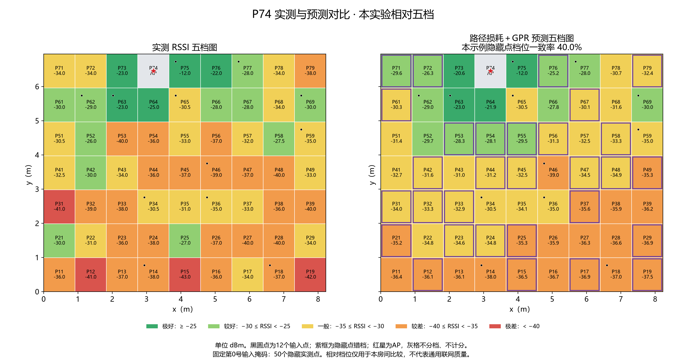

# zihexie95-dotcom 的模型训练与评估

此目录是 @zihexie95-dotcom 提交的独立实验模块，保留训练代码、9 个神经网络权重、4 种数值模型配置、固定评估掩码、汇总数据、指标和热力图。

**与团队根目录实验使用不同划分**：本模块剔除 P26/P49，以 6 组训练、P62 验证、P74 探索性测试；根目录当前使用 P64 验证并保留 P49/P26 重复测试。本模块不替换根目录实验，不跨协议直接比较成绩。

运行以下示例前先进入本模块目录：

```powershell
cd contributions/zihexie95-dotcom/rf-map-models
```

环境采用单独虚拟环境，避免与仓库根目录的 PyTorch 版本混用。数值 GP 推理只需 NumPy。数据由团队共同采集与整理，个人工作归属见 CONTRIBUTIONS.md。

室内 Wi-Fi RSSI 稀疏测量、地图补全、模型对比与五档热力图。

本模块记录 @zihexie95-dotcom 在团队采集数据基础上完成的整理、实验设计、建模评估和可视化工作，代码与文档制作使用了 AI 辅助。**数据由项目团队共同采集与整理，不作为个人独占成果。** 详细分工见 [CONTRIBUTIONS.md](CONTRIBUTIONS.md)。




## 数据与实验

- 房间 8.23 × 6.95 m，7 行 × 9 列；P11 在左下角，P79 在右上角。
- 剔除两组存疑数据 P26、P49，保留 8 组、495 个有效点位中位数。
- 按整组划分：训练 P16/P22/P28/P44/P64/P68；验证 P62；测试 P74。样本不足时实际为 6/1/1，没有另外保留泛化组。
- 每组使用 6/12/24 个输入点，均匀或聚集分布，各 10 个固定掩码；三个神经网络各训练三个随机种子。
- 只在未作为输入的有效实测点计算指标；缺测值保持 NaN，AP 所占点不参与评分。
- P74 在早期实验中曾用于验证。本轮是探索性重新划分，不能视为全新盲测，也不能据此证明新房间泛化能力。

这里提交的是去除设备标识后的点位汇总及固定掩码，不包含完整原始采样包、微信文件或设备网络地址。见 [DATA_CARD.md](DATA_CARD.md)。

## 结果

P74、12 个均匀输入点、10 个固定掩码；神经网络指标取三个训练种子的均值。

| 方法 | MAE（dB） | RMSE（dB） | 误差 ≤5 dB |
|---|---:|---:|---:|
| IDW | 4.259 | 5.434 | 64.2% |
| 普通 GPR | 4.143 | 5.340 | 66.0% |
| 路径损耗 | 3.566 | 4.379 | 76.8% |
| 路径损耗 + GPR | **3.563** | **4.356** | 75.4% |
| 卷积自编码器 | 4.562 | 5.939 | 63.5% |
| 小型 U-Net | 4.731 | 6.112 | 62.3% |
| 残差 U-Net | 4.313 | 5.483 | 65.7% |

路径损耗 + GPR 按验证集选定；本例 RMSE 比 IDW 低约 19.8%，但比纯路径损耗只低约 0.023 dB，尚不足以宣称复杂模型具有稳定优势。当前数据下神经网络没有超过物理先验方法。

五档是本实验的相对分级：极好 ≥−25；较好 [−30,−25)；一般 [−35,−30)；较差 [−40,−35)；极差 <−40 dBm。这些名称不代表通用 Wi-Fi 服务质量，也不能推算网速。相同评估下，路径损耗 + GPR 五档完全一致率 42.4%，相差不超过一档 92.4%。封面固定示例的完全一致率为 40%，与跨十个掩码汇总指标不同。

## 运行

已验证环境为 Python 3.13、NumPy 2.5.4、PyTorch 2.14.1 CPU、Matplotlib 3.11.2。`requirements-lock.txt` 保存实验环境完整版本。

```powershell
python -m venv .venv
.venv\Scripts\python -m pip install -r requirements.txt

# GP 预测只需要 NumPy；不会读取完整参考地图
.venv\Scripts\python gpr/code/infer.py --model gpr/models/pathloss_gpr.json --points examples/demo_inputs.csv --ap P74 --output scratch/predicted.csv

# 本地实验助手：预测五档并推荐 3 个补测点，无远程 API 调用
.venv\Scripts\python scripts/assistant_tools.py --points examples/demo_inputs.csv --ap P74 --count 3 --output scratch/assistant_result.json

# 最小验证
.venv\Scripts\python scripts/verify_release.py
```

重新训练与评估（会覆盖本地对应结果）：

```powershell
python neural/code/train.py
python neural/code/evaluate.py
python gpr/code/run_experiment.py
python scripts/plot_five_levels.py
```

`gpr/` 是 NumPy 实现的路径损耗、IDW 和 GPR；`neural/` 是 PyTorch 模型和训练评估；`results/five_levels/` 是五档图、混淆矩阵及逐点对比；根目录 CSV 为合并指标。完整分析见 [评估报告](剔除两组数据后的评估报告.md)。

## 与大模型结合

推荐“大模型理解任务 → 调用本地数值工具 → 根据实际返回结果解释与规划”。现有预测器提供数值依据，大模型负责自然语言交互、实验检查、报告和补测建议。已提供可运行的本地工具示例；**尚未连接远程大模型，也未消耗 API 额度。** 方案、接口和验证方法见 [LLM_INTEGRATION.md](LLM_INTEGRATION.md)。

进一步的 AI 方向是主动测量闭环：根据当前观测选点、获得新测量、更新地图，再继续决策。已增加[离线回放实验](results/active_sampling/主动测量评估.md)，公平对比随机、最远点空间覆盖与 GPR 方差采样。12 点预算下，P62 的 GPR 方差采样 RMSE 比随机低约 5.6%，P74 则高约 0.8%，尚无稳定优势。运行 `python scripts/benchmark_active_sampling.py` 可复现。`assistant_tools.py --exclude P11 P12` 支持不可测区域约束。未来接入路线见 [AI 深化方案](AI_ROADMAP.md)。
