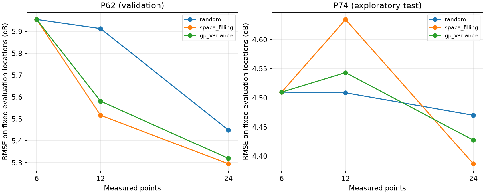

# 主动测量离线回放

这是新增的 AI 决策实验：让固定 GPR 模型按当前观测的不确定性选择下一测点，读取该点已有实测值后更新预测。对照为随机选点和最远点空间覆盖策略。三者使用相同预测模型，只比较选点方式。

每组回放 20 次，每次固定留出 20 个评估位置，整个过程中不允许查询；其余位置为候选池，三种策略从相同 6 点起步，增加到 12/24 点。评估位置在同次回放的不同预算和策略间保持不变，避免“把困难点测掉”导致评分虚高。空间覆盖策略是最远点采样，不等同于原实验均匀掩码。

| 组别 | 测点数 | 选点方式 | RMSE（dB） | 五档完全一致 | 相差≤一档 |
|---|---:|---|---:|---:|---:|
| P62 | 6 | random | 5.955 | 34.8% | 81.0% |
| P62 | 12 | random | 5.913 | 32.0% | 82.0% |
| P62 | 24 | random | 5.449 | 37.5% | 81.8% |
| P62 | 6 | space_filling | 5.955 | 34.8% | 81.0% |
| P62 | 12 | space_filling | 5.517 | 35.0% | 84.8% |
| P62 | 24 | space_filling | 5.294 | 38.8% | 85.8% |
| P62 | 6 | gp_variance | 5.955 | 34.8% | 81.0% |
| P62 | 12 | gp_variance | 5.581 | 36.5% | 83.0% |
| P62 | 24 | gp_variance | 5.319 | 39.8% | 85.2% |
| P74 | 6 | random | 4.510 | 42.2% | 90.0% |
| P74 | 12 | random | 4.509 | 41.5% | 90.0% |
| P74 | 24 | random | 4.470 | 43.0% | 90.5% |
| P74 | 6 | space_filling | 4.510 | 42.2% | 90.0% |
| P74 | 12 | space_filling | 4.635 | 41.2% | 89.8% |
| P74 | 24 | space_filling | 4.387 | 42.0% | 92.0% |
| P74 | 6 | gp_variance | 4.510 | 42.2% | 90.0% |
| P74 | 12 | gp_variance | 4.543 | 42.8% | 89.5% |
| P74 | 24 | gp_variance | 4.427 | 43.5% | 91.5% |

P62 在 12 点预算下，GP 方差选点相对随机选点的 RMSE 降幅为 5.6%（负值表示更差）。

P74 在 12 点预算下，GP 方差选点相对随机选点的 RMSE 降幅为 -0.8%（负值表示更差）。

## 如何解读

- 只检验已有模型的方差采样策略，不代表大模型已接入，也不是强化学习。
- GPR 核参数保持固定；每增加一个真实观测，更新后验地图。固定核下方差不依赖观测值，不能把方差策略描述为学习了现场语义或新的选点策略。
- P62 用于既有模型选择；P74 曾在更早实验中作为验证组。这是探索性回放，不能当作新的盲测或跨房间泛化。
- 每个预算 400 次评分是 20 点×20 次回放，位置会重复，不是 400 个独立场景；曲线不保证单调，不保证方差选点优于随机或空间覆盖。
- 这是新的固定留出点评估，与原来“所有未测点评分”的数值不能直接比较。
- `selection_traces.json` 记录每次观测与评估位置。选点器只接收已测值和允许点位，不接收未测 RSSI；评估标签由独立的回放循环保管。

补充工具能力：`assistant_tools.py --exclude P11 P12` 可以排除禁止进入或无法测量的位置。未来大模型可把用户的现场约束转换为点位限制，再调用工具重新规划；这里暂未执行远程大模型。

研究参考：[Bayesian Active Learning for Sample Efficient 5G Radio Map Reconstruction](https://doi.org/10.1109/TWC.2024.3483112)。该论文研究 GP 与主动测量结合；本项目只做简单单 GP 方差基线，不声称复现其集成模型或论文结果。
